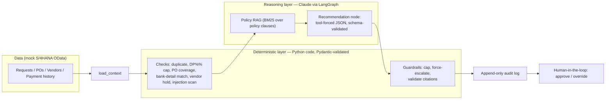

# P2P Down-Payment Approval Agent (SAP FI-AP)

An LLM agent that reviews vendor **down-payment requests** against PO terms, vendor history,
and payment policy, and recommends **APPROVE / HOLD / ESCALATE** with reasons that cite the
underlying data. The agent **never posts or releases a payment** — its only output is a
recommendation handed to a human approver.

> **Note:** This is a portfolio project. SAP is mocked behind OData-style endpoints;
> evaluation runs on synthetic cases. `docs/sap-integration.md` explains exactly how the same
> agent connects to a real S/4HANA system and how a legitimate production project differs.

## Architecture in one picture



## Design invariants (non-negotiable)

1. **Numbers are code.** Amounts, limits, duplicates, and bank matching run as plain Python
   behind Pydantic schemas — never as LLM arithmetic.
2. **Guardrails are code.** A failed *hard* check caps the label at `HOLD`/`ESCALATE`
   regardless of what the model says; bank mismatch or prompt injection *forces* `ESCALATE`.
   The model can attempt an unsafe approval — the guardrail rejects it.
3. **Every claim cites evidence.** Citations are validated against the evidence pool
   (check evidence IDs + policy clause IDs); invalid citations are stripped.
4. **The agent has no write path to SAP.** The tool surface contains no payment-posting
   capability, so such unsafe actions are not possible, not merely discouraged.
5. **Every decision is logged** with its checks, draft, guardrail actions, and final label.

## Quickstart

```bash
pip install -e ".[dev]"
pytest                          # unit + pipeline + eval gates
python evals/run_eval.py       # synthetic decision-accuracy suite (unsafe approvals must be 0)

# optional: reason with Claude (otherwise a deterministic offline recommender runs)
export ANTHROPIC_API_KEY=sk-ant-...
uvicorn dpa_agent.api.main:app --host 0.0.0.0 --port 8000
```

Try it:

```bash
curl -s localhost:8000/api/v1/requests | python -m json.tool
curl -s -X POST localhost:8000/api/v1/requests/DPR-2026-0001/evaluate | python -m json.tool
```

## Repo layout

| Path | What it is |
|---|---|
| `src/dpa_agent/models/` | Pydantic contracts: requests, checks, recommendations, graph state |
| `src/dpa_agent/sap/` | OData-style SAP access: in-memory mock + HTTP client |
| `src/dpa_agent/tools/` | Deterministic checks (the "tools" the agent calls) |
| `src/dpa_agent/rag/` | Policy store + BM25 retrieval over clause-ID'd policy docs |
| `src/dpa_agent/llm/` | Claude client (tool-forced JSON) + offline fallback recommender |
| `src/dpa_agent/guardrails.py` | The code that makes unsafe approvals impossible |
| `src/dpa_agent/graph/` | LangGraph state machine wiring it all together |
| `src/dpa_agent/api/` | FastAPI: list requests, evaluate, record human decisions |
| `evals/` | Synthetic cases: duplicates, over-limit, bank mismatch, injection |
| `docs/` | Architecture notes + real-SAP integration guide |

## Architecture Rationale

Agentic review with deterministic guardrails and human-in-the-loop is the standard pattern
for LLM systems in finance: the model handles unstructured reasoning (vendor notes, policy
prose), code handles anything where being wrong costs money, and a human keeps authority.
See `docs/architecture.md` for the layer-by-layer rationale and `docs/sap-integration.md`
for the SAP side.

## Roadmap

- [x] Deterministic checks + guardrails + audit log
- [x] LangGraph pipeline with Claude (tool-forced JSON) and offline fallback
- [x] Mock OData-style SAP access + FastAPI surface
- [x] Synthetic eval suite wired into CI (unsafe-approval gate = 0)
- [ ] Embedding-based retrieval option (interface already pluggable)
- [ ] Shadow mode: compare recommendations against historical human decisions
- [ ] SAP Build Process Automation / My Inbox integration (see docs for design)
