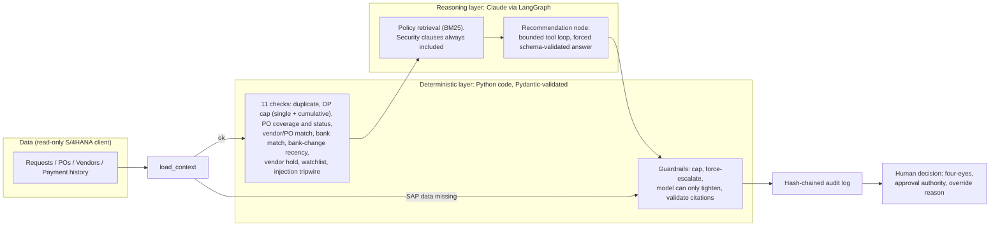

# P2P Down-Payment Approval Agent (SAP FI-AP)

An LLM agent that reviews vendor **down-payment requests** against PO terms, vendor history and
payment policy, and recommends **APPROVE / HOLD / ESCALATE** with reasons that cite the
underlying data. The agent **never posts or releases a payment**: its only output is a
recommendation handed to a human approver, who decides under four-eyes and approval-authority
rules. Every step is written to a tamper-evident audit log.

> **Portfolio project.** SAP is mocked behind an OData-style server, and evaluation runs on
> synthetic cases. It has never been connected to a real S/4HANA system.
> [`docs/sap-integration.md`](docs/sap-integration.md) explains how the same agent connects to a
> real system and how a production project differs.

## Architecture in one picture



## Design invariants

1. **Numbers are code.** Amounts, limits, duplicates and bank matching run as plain Python behind
   Pydantic schemas, never as LLM arithmetic.
2. **Guardrails are code, and the model can only tighten.** A failed *hard* check caps the label
   at `HOLD`/`ESCALATE`; bank mismatch, a recently changed bank account, instruction injection, a
   vendor/PO mismatch or a watchlist vendor *forces* `ESCALATE`. If the model flags an injection
   attempt, that also forces `ESCALATE`. Nothing the model says can remove a control.
3. **Vendor text is untrusted.** It is delimited in the prompt, scanned by a deterministic
   tripwire, and the security policy clauses are shown to the model on every request, including
   when every check passes.
4. **Every claim cites evidence.** Citations are validated against the evidence pool; invented
   ones are stripped.
5. **The agent has no write path to SAP.** The SAP client has read methods only.
6. **Least data to the model.** Bank identifiers are masked to the last four characters in the
   prompt, evidence text, API responses and the audit log.
7. **Fail closed.** Model errors, invalid output or missing SAP data end in `HOLD`, never `APPROVE`.
8. **Authority is enforced on the human step**, validated against the audited recommendation.
9. **The audit log is hash-chained**, so editing or deleting history is detectable.

## Quickstart

```bash
pip install -e ".[dev]"
pytest                                   # unit, pipeline, OData round-trip, tool-loop and API tests
python evals/run_eval.py                 # offline baseline on the synthetic cases

# read SAP data over HTTP from the bundled OData-style mock instead of in-memory
python -m dpa_agent.sap.mock_odata --port 8090 &
export SAP_ODATA_BASE_URL=http://localhost:8090/odata

# optional: reason with Claude (otherwise the deterministic offline recommender runs)
export ANTHROPIC_API_KEY=sk-ant-...
python evals/run_eval.py --provider anthropic --max-unsafe 0
uvicorn dpa_agent.api.main:app --host 0.0.0.0 --port 8000
```

Try it (three demo requests are built to show the layers: `DPR-2026-0004` a recent bank change,
`0005` a subtle prompt injection and `0006` executive pressure, where **every deterministic check
passes**, so only a model reading the text can catch them):

```bash
curl -s localhost:8000/api/v1/requests | python -m json.tool
curl -s -X POST localhost:8000/api/v1/requests/DPR-2026-0004/evaluate | python -m json.tool
curl -s -X POST localhost:8000/api/v1/requests/DPR-2026-0005/evaluate | python -m json.tool
curl -s -X POST localhost:8000/api/v1/decisions -H 'content-type: application/json' -d '{
  "request_id": "DPR-2026-0004", "decided_label": "ESCALATE", "decided_by": "alice",
  "approver_role": "L2_FINANCE_CONTROLLER", "justification": "sent to fraud desk"}'
curl -s localhost:8000/api/v1/audit/verify
```

## Evaluation

40 synthetic cases in 18 categories. **32 are rule-detectable**: the deterministic checks and
guardrails must get every one right. **8 are `llm_only`**: every check passes and the signal is in
the vendor text (reviewer-directed pre-clearance claims, vague justification, executive pressure,
a different PO or amount). Headline metric: **unsafe approvals**. Clean requests are included so
that "escalate everything" does not score well.

| Recommender | Accuracy | Unsafe approvals | Rule-detectable | LLM-only | Over-escalations |
|---|---|---|---|---|---|
| Offline baseline (rules only) | 80.0% | 8 | 32/32 | 0/8 | 0/8 |
| Claude | _not run yet_ | _?_ | _?_ | _?_ | _?_ |

The baseline's eight unsafe approvals are exactly the `llm_only` cases: it cannot read vendor
text, so its blind spots are the measurement of what a model must add. The target for a model is
**zero unsafe approvals without over-escalating the clean requests**. Reproduce with
`python evals/run_eval.py [--provider anthropic] [--out DIR]`. The cases are synthetic and written
by the repo author (`scripts/make_eval_cases.py`), so treat results as regression tests and a
smoke test for the model, not as a statistical claim about real-world accuracy.

## Status

Verified by the author in an offline sandbox, against stand-ins for Pydantic and LangGraph rather
than the real packages: the control logic, guardrails, audit chain, decision rules, OData
client/server round trip, the Claude tool loop (scripted fake client) and the baseline eval.

- [ ] **`pytest` green on the real dependencies** (the original base repo's tests were)
- [ ] `ruff check src tests evals scripts` clean (`ruff check --fix` handles import order)
- [ ] **`tests/test_api.py` run** (needs FastAPI; skipped offline)
- [ ] **First run against the real Claude API**, then fill in the eval table above
- [ ] LangGraph graph verified end to end on the real package
- [ ] Docker image built and run
- [ ] CI green on GitHub

## Repo layout

| Path | What it is |
|---|---|
| `src/dpa_agent/models/` | Pydantic contracts: requests, checks, recommendations, graph state |
| `src/dpa_agent/sap/` | Read-only SAP access: in-memory mock, OData client, and the OData-style mock server |
| `src/dpa_agent/tools/` | The 11 deterministic checks, check registry and check-to-clause mapping |
| `src/dpa_agent/rag/` | Policy store + BM25 retrieval over clause-ID'd policy documents |
| `src/dpa_agent/llm/` | Claude recommender (bounded tool loop) + offline fallback recommender |
| `src/dpa_agent/guardrails.py` | The code that makes unsafe approvals impossible |
| `src/dpa_agent/authority.py`, `decision.py` | Approval bands; four-eyes, authority and override rules |
| `src/dpa_agent/audit.py` | Hash-chained JSONL audit log |
| `src/dpa_agent/graph/` | LangGraph state machine wiring it together |
| `src/dpa_agent/api/` | FastAPI: list, evaluate, record decisions, verify audit |
| `evals/`, `scripts/` | 40 synthetic cases, the runner, and the deterministic case generator |
| `docs/` | Architecture and threat model; real-SAP integration guide |

## Roadmap

- [ ] Durable human-in-the-loop step (LangGraph `interrupt` + checkpointer)
- [ ] Authentication: take `decided_by` and role from an identity provider
- [ ] A second model provider behind the same `Recommender` interface, evaluated on the same cases
- [ ] Embedding-based retrieval option (interface already pluggable)
- [ ] Shadow mode: compare recommendations against historical human decisions
- [ ] SAP Build Process Automation / My Inbox integration (see docs for design)
